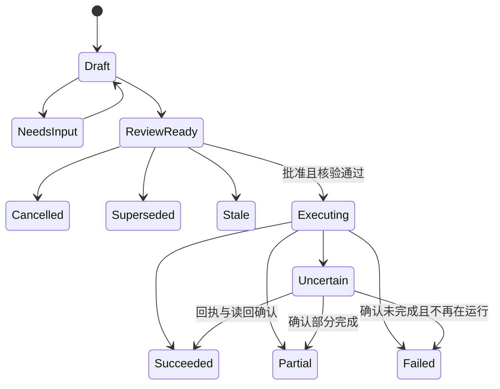

# 业务 CLI、状态与错误契约

设计草案 1.0；尚未实现。这里规定公开接口和不变式，具体字段由注册表生成 Schema。

## 1. 命令层级

CLI 发行名拟定为 `cosmos`；直接运行 Node 发行文件等价。标准输出只有一个 UTF-8 JSON 结果，诊断写 stderr；支持 `--json` 默认输出和供人阅读的 `--pretty`。输入支持 UTF-8 stdin 或文件，文件只是输入载体，不是执行状态。技能只需知道一个入口。

```text
cosmos help [command]
cosmos inspect capabilities
cosmos query notes|tasks|actions --input <file|->
cosmos task preview --input <file|->
cosmos entity preview --input <file|->
cosmos change preview --input <file|->
cosmos draft open --input <file|->
cosmos draft preview --draft <id> --input <file|->
cosmos review show --review <id>
cosmos review commit --review <id> --confirm
cosmos review cancel --review <id>
cosmos execution status --execution <id>
cosmos execution verify --execution <id>
cosmos publish preview --input <file|->
cosmos publish commit --review <id> --confirm
```

业务命令生成预览，只有 commit 可以执行已审阅的写入。`inspect/query/show/status/verify` 不产生业务变更。`cancel` 更新库外计划状态，不回滚实际已完成写入。安装、维护和退役是独立管理命令，不混入日常技能。

未批准时调用 commit 不写入。`--confirm` 的含义明确为宿主已取得当前方案的用户授权；它不是身份认证或独立真人证据。若注册可信批准来源，则另提供宿主收据适配接口。

## 2. 数据输入

输入不接受 `planHash`、执行器路径、原始脚本、任意保存路径或旧 preparedOperationId。属性及业务操作经闭合 Schema 验证；不默默丢弃未知字段。名称与目标查询有歧义时返回候选，不选第一个。

任务示意：

```json
{
  "title": "整理面试材料",
  "schedule": {"date": "2026-10-12", "time": "09:00", "timeZone": "Asia/Shanghai"},
  "estimateMinutes": 30,
  "priority": {"rank": "highest"},
  "relations": {"project": "已有项目的精确标识"},
  "details": "只整理已有材料，不添加未完成的项目经历。"
}
```

具体日期优先；允许结构化相对日期时必须含时区、基准语义和相对天数，由代码在草稿准备时换算一次。跨日批准使用已预览的具体值。预计时长不能自动变成截止时间。状态和优先级以当前 TaskNotes 目录为准，中文标签只有唯一匹配才转换。

一般实体输入包含实体或已登记分类、名称、允许的属性/关系和本操作需要的内容。实体/分类都缺失而影响实际位置时返回 `needs-input`。没有事实的字段可标为 unknown 并给原因，不能为满足结构编造事实。

变更请求由有限动作构成，例如 `entity.evolve`、`content.patch`、`file.rename`；模型不指定具体插件函数。跨文件关系先解析到稳定目标，再写入实际对应字段。

## 3. 草稿和动态内容

`draft open` 内部锁定选择依据、实际模板和输入事实，输出：

```json
{
  "ok": true,
  "state": "needs-content",
  "draftId": "opaque-draft-id",
  "contentContract": {
    "title": "本次适用模板",
    "fields": [{"id": "slot-1", "label": "实际章节", "kind": "text"}]
  },
  "missing": [],
  "next": {"command": "draft preview", "draftId": "opaque-draft-id"}
}
```

ID 不含文件路径和可变属性。字段映射由代码保存，模型只填 fields。模板、映射算法或影响本次选择的规则变化，draft 失效并返回需重建原因。模型不能用同一草稿切换目录或公开范围。

draft 内部修改会增加 revision。每次 preview 创建新 review；旧 review 标记 superseded。若只有非业务解释变化，也不能原地更换用户已看过的完整预览字节。

## 4. 实际预览

预览成功返回：

```json
{
  "ok": true,
  "state": "review-ready",
  "reviewId": "opaque-review-id",
  "summary": {
    "changes": [{"action": "task.create", "path": "经当前库解析的实际路径"}],
    "warnings": []
  },
  "preview": {"path": "由代码保存的库外完整预览", "format": "markdown"},
  "next": {"command": "review commit", "reviewId": "opaque-review-id"}
}
```

完整预览包含目标、操作、实际属性、完整正文或差异、关联、附件/发布范围及风险。摘要不能替代完整预览。没有成功生成 review 时不展示虚构编号或说“方案已准备”。

执行计划保存规范化业务数据、解析后的目标、模板映射版本、规则/服务版本、相关文件和关系指纹、目录约束、准确操作集合及预览字节指纹。全库无关文件变化不使计划失效，影响目标或依赖的变化必须拒绝。对冲突目标、空文件、并发新增及符号链接重新检查。

## 5. 状态转移



Draft、NeedsInput 保存于草稿存储；其他状态属于 review 和 execution，不能由模型任意设置。ReviewReady 可以提交一次；重复 commit 读取已有 execution 状态，不生成第二次写入。依赖过期后回到新草稿路径，需要新 review。

程序崩溃、取消进程或超时不证明应用内写入已经停止。Uncertain 不能直接转回 ReviewReady 自动重试。对“继续”读取原状态；对“取消后继续”继续保持取消，除非用户明确批准新方案。

## 6. 提交与复检

提交内部顺序：解析 review → 检查确认和状态 → 重新核验相关依赖及实际环境 → 获取库锁 → 保存执行 ID 与派发前记录 → 运行登记动作 → 收最终回执 → 读回文件/插件状态 → 更新结果 → 返回摘要和实际链接。

检查在锁内重复关键冲突核验，避免锁前检查和写入之间的竞态。实现不保证跨多个文件绝对事务，批量结果明确部分完成。只有可证明安全的局部补偿可自动执行，不能按猜测回滚用户的并发编辑。

结果中 `ok/state` 与 `verified` 分开：服务返回成功但读回不符，不能声称已全部通过。`result.saved:false` 不改变既有写入状态，不能触发重发。

## 7. 错误契约

```json
{
  "ok": false,
  "error": {
    "code": "TARGET_AMBIGUOUS",
    "message": "存在多个同名目标，需要选择。",
    "field": "relations.project",
    "details": {"candidates": []},
    "recovery": {"kind": "choose", "safeToRetry": true}
  }
}
```

| 错误族 | 处理 |
| --- | --- |
| INVALID_INPUT / UNKNOWN_FIELD | 返回精确字段和允许格式，未进入写入 |
| TARGET_AMBIGUOUS / NEEDS_INPUT | 返回最小候选或缺失信息，保持草稿 |
| TEMPLATE_STALE / REVIEW_STALE | 保留旧预览只读；重新生成方案 |
| CAPABILITY_MISSING / WRONG_VAULT | 不派发，明确缺少的接口或绑定 |
| EXECUTION_PARTIAL | 返回已完成、失败及未开始步骤，不重新执行完成部分 |
| RESULT_UNCERTAIN | 返回 execution ID，只查回执和读回；safeToRetry=false |
| VERIFICATION_FAILED | 记录实际与预期差异，不伪造成功或自动全库修复 |

CLI exit 0 表示已返回有效查询、草稿、预览或经验证的执行结果；2 表示输入/业务条件错误，3 表示环境能力错误，4 表示执行失败或部分完成，5 表示结果不确定。消费者同时以 JSON 的 state 和 verified 判断；不能将“已生成预览”说成“已写入”。发布网络错误保留批次 ID、远端状态与明确恢复建议，不将网络超时当作远端未发生。

## 8. 可选 MCP 与版本

若交付 MCP，只映射上述高层服务，不额外暴露旧 prepare/plan 内部组合。两种入口使用同一输入校验、状态和业务实现。传输协议、状态存储、内容契约、运行时接口分别版本化；发行 manifest 记录它们及源 SHA。

旧协议不在新公开 API 中兼容执行。迁移器单独读取旧状态，并通过明确转换/失效规则处理；不保持旧运行时可执行依赖。
