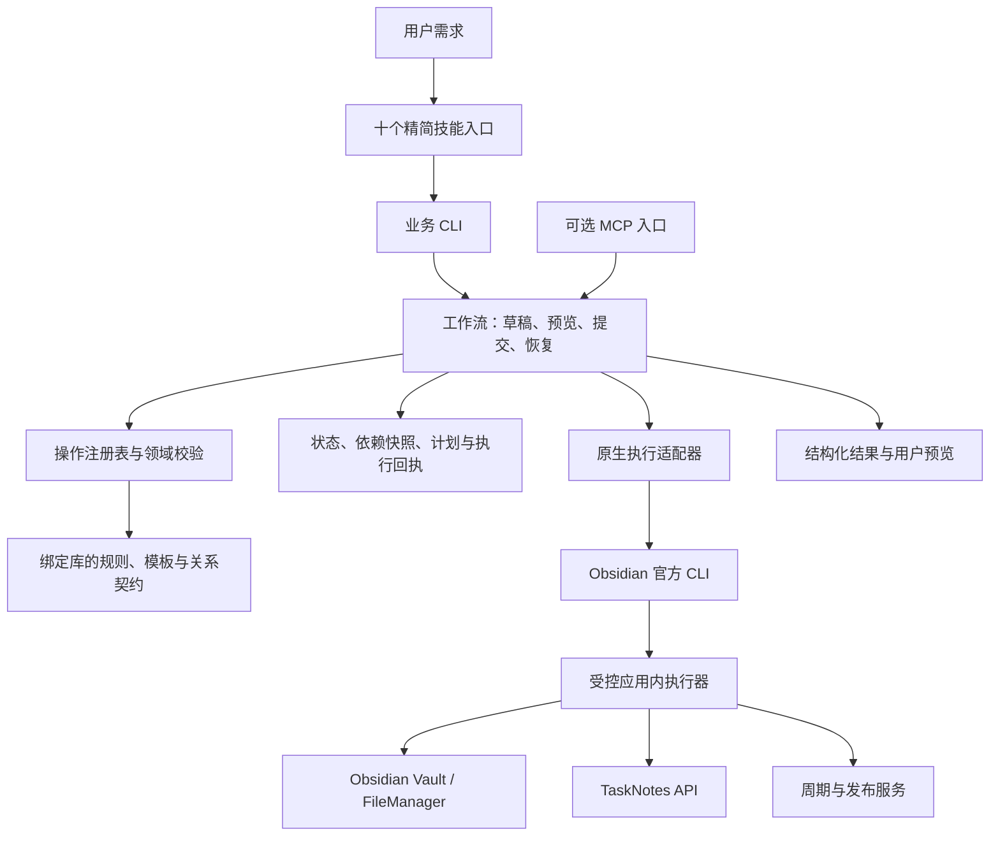

# Cosmos Obsidian 完整开发设计

版本：设计 1.0，2026-10-11。状态：**用户已批准设计与实施计划，独立开发已启动。本文是目标契约；实际完成情况见实施记录。**

## 1. 用户决定与本轮交付

本项目按 2026-10-11 的决定独立重建：保存全部调研结果，冻结现有技能，建立新公开仓库和新工作区；先提交完整开发文档，审阅通过后开发。允许继承旧实现的优点，但每项必须分析；不再向旧技能追加补丁。新技能完成、GitHub Actions 编译和所有必需测试通过后，删除旧技能的本地文件与远程仓库。

本轮可审阅的交付是新仓库、冻结记录、调研归档和这组设计文档。尚不编译、不实施、不安装新技能，也不提前删除旧文件。当前安装保持现状，冻结指停止其维护与更新。

新项目：`Self-Command/cosmos-obsidian`，本地独立目录 `cosmos-obsidian`。不从旧仓库 fork，不复制旧 Git 历史，不依赖旧目录运行。项目规则继续禁止子代理及委派。

## 2. 要解决的具体问题

旧系统已经有规则校验和执行代码，但面向模型的入口仍要求模型串接 prepare、plan、apply、check，保存多份 JSON，选择结果指针并传递内部状态。提示词承担了太多流程调度。格式合规和业务调用数量合格，未能保证真实会话快且稳定。

新系统将这类机械流程纳入代码。对材料齐全的任务，模型给业务数据，代码生成实际预览；批准后代码执行与复检。对长正文，代码先提供适用模板的字段和写作要求，再接收模型内容。模型无需复制模板指纹、执行哈希、内部结果文件路径或低层操作链。

本次不是单纯缩短 SKILL.md、改名打包或继续封装旧入口。CLI、状态模型、业务注册表、错误恢复、打包和行为验收都重新设计；旧规则与有效机制通过逐项审查选择继承。

## 3. 需求和完成标准

| ID | 需求 | 可观察结果 |
| --- | --- | --- |
| R01 | 代码承担规则 | 未登记分类、错误关系、不合法阶段、过期预览、错库和非法字段由代码拒绝 |
| R02 | 代码管理流程 | 简单任务一次预览命令，批准后一次提交命令；内部执行和复检不交给模型串接 |
| R03 | 精简技能 | 十个职责入口可发现，正文不重复机器约束，不要求模型重读整套规范 |
| R04 | 原生执行 | 使用已有官方 CLI；任务复用 TaskNotes，移动与属性用 Obsidian 服务 |
| R05 | 实际模板 | 从绑定库读取当前规则和模板，仅向模型返回本操作需要的写作结构 |
| R06 | 保留知识库语义 | 18 类实体、七个世界、当前目录、38 个模板及插件分工经契约核验后覆盖 |
| R07 | 可审阅写入 | 实际完整预览、绑定范围和依赖，批准后执行原方案；取消或未批准不写 |
| R08 | 可恢复且不重复 | 中断后使用已保存状态；写入结果不确定时查回执，不重新派发 |
| R09 | 独立发行 | 安装、发现和运行不引用旧仓库、旧执行器或旧状态路径 |
| R10 | 全部验证在 Actions | 构建、各类自动测试、原生运行时及真实模型验收指向同一候选 |
| R11 | 真实速度合格 | 同环境记录模型回合、额外探索、宿主调用及总耗时；不以单元测试代替 |
| R12 | 可控迁移和彻底退役 | 新技能通过后切换，迁移必要状态，再按精确清单删除旧技能及旧远程仓库 |

不更改知识库的业务规则、模板、用户笔记、插件开关、账号、模型或权限来迁就新实现。不安装新的 LLM 产品或强制新增 MCP；MCP 若保留，只是同一业务服务的可选传输。

公开发行不包含用户库、私人正文、会话、凭据和本机绝对路径。合成样例可公开；原生日志和必要私有清单单独保存。

## 4. 研究结论如何进入设计

主要参考 TaskNotes 的原生服务复用、TaskNotes Workflows 的步骤控制、Obsidian Copilot 的集中 CLI 客户端。Notion 的工程说明支持面向业务的接口粒度，Blinko 支持让不同调用入口复用同一业务能力。相关机制和边界见[调研索引](research/README.md)。

本次明确舍弃“在旧引擎外再套一点辅助选项”的原建议。新项目保留语义需求，重新拆分模块和公开接口；源码继承须经过[逐项审查](design/reuse-audit.md)。外部项目的存在、星数、README 声明或旧 CI 成功都不作为新项目通过证据。

## 5. 架构决策



### 5.1 技术与模块

采用 TypeScript、Node LTS（构建时固定明确版本）、JSON Schema 校验、Markdown AST 解析和 esbuild 打包。具体依赖版本在实施阶段查询官方版本并锁定，不直接复制旧 lockfile。测试使用具备 Windows/Linux 支持的运行器；依赖选择须符合实际使用和许可证。

先采用一个仓库、一个发行包，按目录划分边界，不为模块数创建微服务或复杂 monorepo：

```text
src/
  cli/             命令解析、UTF-8 输入、帮助、输出和退出码
  workflows/       查询、草稿、预览、提交、恢复、取消
  registry/        注册业务操作与其 Schema、效果、权限类型
  domain/          实体、关系、目录、生命周期、任务、周期、发布
  templates/       当前模板解析、可写字段、内容验证与渲染
  state/           草稿、不可变计划、执行日志、锁、迁移
  adapters/        Obsidian CLI、TaskNotes、周期和发布契约
  runtime/         受控应用内执行与读回，禁止任意用户代码
skills/            十个精简 SKILL.md 及必要写作参考
tools/             CI 打包、产物核验、安装和受控迁移
tests/             领域、流程、传输、包、原生宿主、行为验收
docs/              设计、调研、继承记录和发布证据
```

### 5.2 单一业务注册表

每个可执行动作登记稳定 ID、输入 Schema、目标类型、所需能力、读取依赖、写入范围、预览函数、执行函数、复检函数及失败策略。CLI 帮助、输入验证、可选 MCP 描述和契约文档从注册数据生成。

注册表只包含实现并验证的能力。不允许模型给原始 `eval`、插件内部路径、任意模块或任意 JSON 指针来扩展动作。写作参考由实际模板或必要领域说明提供，不将所有机器 Schema 塞入技能正文。

### 5.3 两条内容路径

材料齐全且模板可由现有数据确定的任务：`task preview` 内部完成准备、规则核验、内容渲染和方案保存；只返回方案摘要、完整预览入口和不透明 review ID。

长正文：`draft open` 返回本操作选定的模板字段、写作要点、已有事实及真正缺失的信息。模型提交内容到该 draft 后，`draft preview` 生成不可变方案。草稿可以修改；已经供用户批准的方案不可原地修改。修改生成新方案并使旧方案失效。

一个需求涉及多个文件时，统一保存业务操作集合并预览，不因切换技能重复创建多份方案。代码完成确定性路由；模型处理需要语义判断的类型选择，不让代码用关键词猜测重要歧义。

### 5.4 原生适配器

固定绑定实际 vault 身份和规范路径，显式传入库参数。进程调用使用 argv 和无 shell 模式，统一编码、超时与错误。CLI `eval` 只运行发行包中受控 dispatcher，用户数据通过经过校验的外置请求传入，不能作为代码拼接。

任务通过 TaskNotes 公开运行时 API 执行，探测版本、能力、映射、状态和周期操作。普通属性及改名使用 Obsidian 服务。生命周期与发布适配现有库的真实业务服务，先通过契约验证；不把“函数存在”当作完整语义兼容。

日常不必反复进行全库扫描或发现可执行程序。短期只读能力缓存可减少重复探测，缓存按绑定身份、应用会话与插件版本失效；执行前仍核验相关依赖和实际运行环境。能否减少 CLI 进程数量须经测量后决定，不能删除必要核验换速度。

### 5.5 状态与失败

所有状态保存库外。模型只持有不透明草稿、方案或执行 ID。状态由代码查找，不允许模型指定保存路径或重抄哈希。计划内容、依赖、操作顺序、公开范围和写入目标纳入不可变指纹。

执行按库串行，状态在每一步派发前落盘。收到最终回执后读回实际文件和插件状态。结果未明确时保留执行状态与锁，报告 `uncertain`；恢复只查询和核对，不自动重发。批量失败列出已完成和未执行动作，不默认逆转已完成内容。

具体状态转移和错误契约见[接口文档](design/contracts.md)。

### 5.6 批准的边界

代码强制检查存在的实际方案、正确状态、依赖与范围。会话中人类批准由宿主交互传入；基础 CLI 的确认标记是调用者声明，不能包装成真人证明。普通脚本也不能阻止拥有其他写文件工具的模型绕过入口。

本项目不再把厂商会话 JSONL、会话 UUID 或复制长段授权文本作为通用执行前提，也不为修复技能而重写 Claudian。若后续需要可信批准收据，由明确的宿主批准接口提供；该增强须独立审查。当前基线使用原生会话批准行为验收，并如实记录信任边界。

## 6. 技能与业务覆盖

保留十个 `cosmos-*` 职责名称有利于用户习惯和准确发现，但内容重写。设计阶段它们仅是文档中的名字；不在标准发现目录创建与旧技能重复的入口。新包统一连接新 CLI，不复制十份执行器。

| 技能 | 业务能力 | 关键边界 |
| --- | --- | --- |
| cosmos-plan | 解释最小文件组合、复用现有实体 | 咨询不写；模糊需求不扩成大工程 |
| cosmos-create | 普通实体创建及模板内容 | 任务和周期使用专用服务 |
| cosmos-project | 项目、任务、材料及成果组织 | 项目关联不等于将全部材料搬入项目目录 |
| cosmos-learn | 问题、资源、研读、认知和检验 | 来源、个人判断、实际验证结果分开 |
| cosmos-life | 方向、领域、对象、事务、经历、游记及周期记录 | 一次记录无需强制立项目 |
| cosmos-tasks | 查询、创建、日期、状态及重复任务 | 使用真实 TaskNotes 映射与周期语义 |
| cosmos-evolve | 合法推进、补结构、关联创建、七天归档 | 仅实现并验证的生命周期；保留正文顺序 |
| cosmos-amytis | 中英文内容、组织、公开副本、上传与核验 | 发布独立审阅范围；保持身份与批次语义 |
| cosmos-files | 定向内容及关系修改、改名、同阶段移动、回收 | 系统维护、附件清理不混入日常整理 |
| cosmos-check | 实体、路径、属性、关系、执行记录复检 | 检查不自动修复；区分原有与本次问题 |

SKILL.md 包含发现信息、目的、业务判断、一个清楚的执行入口和必要交互说明。详细写作要求按操作返回或按需加载；机器约束的唯一来源是代码。禁止为降低上下文而删除业务内容质量要求。

当前 18 类实体、实际目录及动作见[业务模型契约](design/business-model.md)。覆盖基线需核对 actual schema、目录与模板；18/38 是现有基线，不是硬编码今后只能有这些数量。业务库版本变化时兼容检查与模板契约更新，不能静默猜测。

## 7. 继承方式

先审查旧源码和实际调用关系，记录优点、缺陷、依赖、采用级别和独立验证。可以继承不变式、经过审查的算法或具体小段代码；禁止整目录复制后改名。库内现有业务服务是环境依赖，旧技能执行器是退役对象，两者必须分清。

每次实际采用旧代码时增加来源提交、文件、理由、改造差异、许可证和测试证据。未获得这些记录的代码不进入新实现。旧测试可提供用例意图，断言和夹具需按新接口重做，避免旧 harness 预先教模型正确流程。

## 8. 分阶段开发计划

| 阶段 | 交付 | 完成门槛 |
| --- | --- | --- |
| D0 设计与冻结 | 本文、调研、继承审查、冻结与退役计划 | 用户审阅开发文档，记录反馈及批准版本 |
| D1 契约与基础 | 注册表、Schema、配置、路径和状态存储；Actions 骨架 | 输入、边界、状态转移及产物隐私检查通过 |
| D2 任务完整流程 | task preview、review commit、读回；TaskNotes 适配 | 任务创建/日期/重复/取消/恢复，真实原生契约通过 |
| D3 内容与实体 | 动态模板、draft、普通创建、长游记及研读 | 当前模板契约覆盖、内容质量和中断恢复通过 |
| D4 业务扩展 | 项目、认知、现实、周期、文件与生命周期 | 各入口有正例/非法变更/原生服务验证 |
| D5 写作与发布 | 本地公开副本、身份、批次、上传与上线核验 | 合成远端/受控测试远端覆盖；不发布用户内容测试 |
| D6 技能与发行 | 十技能、独立构建、安装器、宿主发现及模型评估 | 同一候选的全部必需 Actions 与十技能各三个不同架构场景通过；耗时按 2026-10-12 验收约定仅作诊断 |
| D7 迁移与退役 | 安装切换、必要状态迁移、旧目录及远程仓库删除 | 退役证据清单闭合、知识库不变、旧依赖为零 |

阶段不启动另一套产品工程，优先交付任务和长正文两条纵向流程来验证架构。若基础流程不合格，修正新项目，不回到旧仓库打补丁。开发按单代理进行。

## 9. 全部测试与发布证据

完整矩阵、用例、速度和环境条件见[验收设计](design/verification.md)。所有编译和自动运行发生在 GitHub Actions；本机可以编辑源码、检查安装清单和核对下载包指纹，不能本地重新构建“同一候选”。

核心验证分四层：领域与工作流测试、传输与包测试、真实 Obsidian/TaskNotes 原生测试、真实 Claude/Codex 宿主行为与耗时测试。合成或模拟层不得替代原生层。每层指向候选 SHA 和 artifact hash；必需任务未运行、被跳过或超时不算通过。

固定评估基线沿用用户已指定的 `gpt-6-luna / xhigh`，不靠换模型取得速度通过。若当前账户不支持该组合，应报告而非静默替换。公开报告只保存脱敏指标，不包含凭据与私人会话。

## 10. 迁移、清理与未决事项

新包先在库外独立安装与检查，最终原子切换同名技能来源。旧锁和不确定执行不能直接删除；先核对结果，必要历史状态迁入独立格式或只读记录，并使过期方案不可执行。新服务不得运行依赖旧代码的历史计划。

最终清理包含旧 checkout、旧执行器、旧专属技能和宿主链接、旧测试/安装副本、旧配置引用及旧 GitHub 仓库。现有知识库、库内业务服务、其他技能、宿主账号/模型/权限及 Amytis 内容均不在删除范围。所有研究和审查结论先保存新仓库；临时旧源码恢复包也纳入最终退役，不另留暗中依赖。

当前尚需实施验证的事项不是向用户追加决策：GitHub 托管 Windows runner 能否可靠运行真实 Obsidian；TaskNotes 与周期入口的当前能力；发布测试远端如何隔离；发行包性能。各项安排在相应阶段做最小可行性验证，阻塞必需验收时如实报告，不将测试降级为 skip 后继续删除。

**审阅重点：这套职责划分、十技能业务覆盖、逐项继承原则、Actions 验收门槛及最后删除范围。批准后的开发以这一组文档为基线，发生实质变化时更新对应设计与验收条款。**
