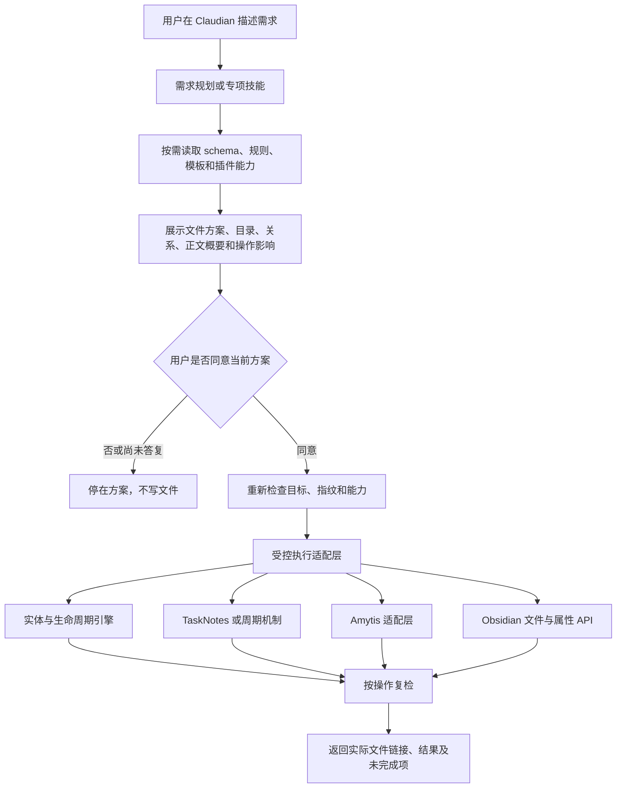

> 历史档案：本文件是旧项目文档的脱敏副本。旧状态、通过项、提议和实现说明不代表新项目状态或验收；当前决定以新开发设计为准。旧私有证据及机器路径没有公开复制。

# Claudian 项目技能开发设计

版本：v1.0，2026-10-08（Asia/Shanghai）
状态：待用户审批；尚未创建、安装技能或执行接口。

## 1. 本轮交付与实施边界

本轮只交付这份开发文档。知识库 `[本机路径已脱敏]` 只读；不增加文件，不调整笔记、模板、脚本、插件配置、AGENTS.md 或启用状态，不执行创建、推进、同步、发布及清理命令。

文档存放在知识库之外：`[本机路径已脱敏]`。研究不使用子代理、不操控桌面界面、不复制私人正文或凭据。

审批通过后的目标是：用户在 Claudian 描述需求，AI 能解释应该创建或修改哪些文件、放在哪里、为什么，以及如何关联；默认先给方案并询问是否由 AI 执行。用户同意后，AI 使用现有项目规则完成指定操作，并给出可核查结果。

本设计保留现有 18 类实体、七个世界、目录职责、原生 tags、独立 route 和插件分工。不另建一套生命周期，不引入后台自动推进，不替换现有可视化面板。

## 2. 已核对的本地基线

| 项目 | 实际发现 | 设计影响 |
| --- | --- | --- |
| Claudian | 2.3.16；插件 ID 为 `realclaudian`，桌面专用 | 使用实际 ID，不能按不存在的 `.obsidian/plugins/claudian` 配置 |
| 当前代理 | `.claudian/claudian-settings.json` 中 `settingsProvider=codex` | 首先验收 Codex 后端；Claude Code 作为兼容后端，不擅自切换账号或代理 |
| 目录／属性模型 | schema v3，directoryVersion=3 | 只使用无编号路径，不恢复旧目录 |
| 正文版本 | `2026-10-04-model-writing-1` | 以当前正文结构和已修复的补齐顺序为基线 |
| 实体／模板 | 18 类实体；38 个模板，现行说明分为 25 个正文模板、13 个命令模板 | 全部登记覆盖，不把命令模板当成笔记正文 |
| TaskNotes | 4.13.8，具有进程内 `plugin.api`，API version=1 | 使用任务 API 和实际字段映射，不按旧插件版本猜接口 |
| Periodic Notes | 0.0.17 | 日周月季年创建与导航继续由周期机制负责 |
| QuickAdd／Templater | 2.12.0／2.25.0 | 原有入口保留；技能不是第二套表单 |
| Amytis | 本地 publish-contract v1，Enveloppe 契约 7.8.2；包含 zh/en 规则 | 调用现有发布适配层，不直接拼接网站文件上传 |
| 归档 | 任务／成果终态日期满足七天确认窗口 | 禁止用修改时间猜测资格；其他类型不冒充已实现 |
| Obsidian CLI | 本次 PATH 检查未发现 `obsidian` 命令 | CLI 传输方案仍待验证，本轮不启用或安装它 |

“已核对”表示本地配置或源码可以证明；不表示实际 Obsidian 界面、代理加载和上传已经验收。

## 3. 架构：技能负责判断，现有服务负责执行



技能采用按需加载：名称和描述用于发现；SKILL.md 保存任务边界和决策流程；细节通过 references 加载；重复且必须稳定的机制放在受控工具中。每个技能不复制整套规则，也不默认加载全部模板。

多个技能由同一个代理按任务读取、衔接，不创建子代理。一个跨域需求使用一个统一操作方案和一次对应的本地执行审批，避免每切换一个技能都重复提问。

## 4. 十个技能及明确分工

所有名称使用 `cosmos-` 前缀，避免与已有技能、命令冲突。用户看到中文说明；实际调用名保持跨后端兼容。下面是拟定名称，本轮没有生成这些技能文件。

| 技能 | 中文名称 | 主要职责 | 不代替的职责 |
| --- | --- | --- | --- |
| `cosmos-plan` | 需求规划 | 从自然语言判断实体组合、阶段、文件和关联；解释后续流程 | 不自动创建，不将每个需求扩展成大项目 |
| `cosmos-create` | 实体创建 | 普通 16 类实体的模板选择、属性、目录和关联创建 | 任务交给 TaskNotes，周期记录交给周期机制 |
| `cosmos-project` | 项目组织 | 构想到项目的立项、材料组织、任务拆解及成果规划 | 不把所有材料搬进项目文件夹，不自动发布 |
| `cosmos-learn` | 认知演化 | 问题、资源、研读、认知、检验的路径与证据组织 | 不把收藏当认知，不替用户宣判检验通过 |
| `cosmos-life` | 现实与记录 | 方向、领域、对象、事务、经历、游记和周期记录 | 不把每篇游记变成项目，不绑定已删除的足迹插件 |
| `cosmos-tasks` | 任务管理 | 任务查询、创建、修改、状态与日期操作、项目／领域关联 | 不直接改 YAML 模拟 TaskNotes 完成和重复任务机制 |
| `cosmos-evolve` | 生命周期推进 | 可执行动作解释、预览、推进、关联创建、正文补齐、归档审计 | 不执行 schema 未实现的封存／重启，不后台推进 |
| `cosmos-amytis` | 写作与发布 | 中英文内容、专题、系列、书籍、公开范围、预检、上传和上线核验 | 不把公开许可当上线状态，不绕过未确认批次 |
| `cosmos-files` | 文件与关系整理 | 查询、正文修改、改名、合法目录内移动、目录整理及受控删除 | 不擅自改业务阶段，不自动清理全库附件或卸载插件 |
| `cosmos-check` | 系统复检 | 校验实体、目录、属性、关联、正文结构及相关配置 | 默认只报告；“检查”不自动等于“修复所有问题” |

拆分理由：任务和周期创建有独立服务；生命周期与一般改名移动有不同语义；Amytis 有外部操作和身份清单；文件删除需要独立影响说明。这些边界不宜全部塞进实体创建技能。

### 4.1 需求规划

用户只说“我想做一个旅行助手”时，先判断是否只是探索想法、已经决定交付，还是仅想记录一次经历。根据输入给出最小足够的方案，不默认生成领域、项目、任务、认知、成果的全套文件。

输出包含：需求理解、建议文件表、已有文件可复用项、可选项、关联示意、尚需确认的信息及下一步。必要信息不足时先展示确定部分，再询问影响类型、目录或公开范围的关键问题。

仅问“怎么做”“放哪里”“这些有什么区别”时，按说明请求处理。默认最后询问“是否需要 AI 按这份方案创建”，不因用户描述了需求就写入文件。

### 4.2 实体创建

读取实体定义、实际目录树和适用模板。依次决定 type、二级阶段、已登记三级分类和已存在的合法更深目录，随后确定状态、主题、真实关联和正文。

有兼容三级分类时必须选定；没有分类时使用合法二级目录。更深目录不得绕过三级职责，表单中的旧直接二级笔记继续兼容。需要新增子目录时单独列入同一审批方案，不暗中创建分类。

正文先由共享引擎生成，再按用户授权补入内容。写作丰富度来自实际目标、过程、证据和上下文；缺少事实时保留待填位置，不编造价格、经历、摘录、成果或来源。书籍研读、游记和 Amytis 使用各自专用结构。

### 4.3 项目组织

构想推进成项目是同一笔记的演化；项目创建关联成果是另建文件。这两种操作必须在方案中解释清楚。

资料按职责存放：外部资源在星尘，研读在上弦，认知在满月，经历在地层，交付物在光球。通过 project 关联，不为方便检索把全部文档迁到吸积。

项目本身不链接自己。目标、范围、里程碑、任务、关键材料与决策分别有作用；不得把文章正文复制进项目作为另一份维护对象。任务拆解后交给任务接口；成果默认草稿，不自动完成项目。

### 4.4 认知演化

先区分太阳课题的“需要解决并交付”与月亮问题的“需要理解”。资源、研读、认知、检验通常通过创建关联笔记衔接，保留来源。

研读区分原文、摘录位置、作者观点、个人解释和未知。认知包含条件、证据、反例及适用边界；检验包含预先判据、过程与实际结果。失败保留证据，需要新问题时另建，不删除原认知或伪造已验证状态。

### 4.5 现实与记录

长期责任用 area，稳定现实资料用 object，反复运行的流程用 routine，一次真实经历用 record，日周月季年用 journal。单次行动继续使用 task。

游记直接创建到 `地球/地层/游记` 或其已有合法子目录，使用游记模板；不要求先建项目，不添加坐标和地图插件要求。发生日期与创建日期分开。

周期记录按日、周、月、季、年各自观察尺度设计，不将日记生命周期推进成周记。任意历史日期的创建能力要根据实际周期入口验证；没有可用接口时只提供正确原生入口，不伪造自动完成。

### 4.6 任务管理

读取 TaskNotes API 的 settings、catalog、model 与 capabilities，使用实际映射和状态原值；中文解释不改变底层状态值。

任务创建、完成、取消、恢复、计划日期、截止日期和重复实例交给 TaskNotes。API 使用的 `projects` 必须根据 fieldMapping 对应到本库 `project`，不直接猜测参数名。area 依据现有自定义字段映射读取和写入。

一次批准只执行列出的任务操作；不默认启动番茄钟、时间跟踪、提醒、重复日程或外部打卡同步。TaskNotes 未启用、初始化未完成或接口版本不符时，明确停止相关操作。

### 4.7 生命周期推进

先查询 availableActions 和资格，展示“移动当前文件／新建关联文件／只改属性或补齐正文”以及目标路径。

执行必须调用 executeAction，不通过直接设置 type、status 和 route 模拟推进。保留旧正文和原章节顺序；新阶段缺少结构追加在后面；不添加“推进前内容（保留）”包装标题，不将构想内容移到底部。未闭合代码围栏等阻碍先报告。

归档仅支持已实现的 task／output 资格；七天窗口读取明确终态日期。不因笔记存放时间较长或 updated 较早就归档。通用退出准备、封存、再激活保持“模型预留、执行未实现”。

### 4.8 Amytis 写作与发布

支持文章、认知、随笔、专题、系列、书籍及章节；登记已有笔记时保留原位置。中英文分别明确 site_locale，不以正文语言猜测，不自动翻译。

专题／系列用有序 site_members，书籍用 site_outline；不从 project 自动生成网站组织，不维护第二份重复章节清单。目录页与每个成员分别检查公开许可。

操作分成：写作和组织 → 登记及公开范围 → 本地预检 → 明确上传 → 合并状态 → 上线核验。首次登记已有笔记必须由用户选择整篇或公开区间，不擅自猜测私人内容。

稳定 site_id、site_slug 和远端映射保持；本地改名不自动改网址，网站标题由 title 决定。修改正文后重新预检。存在 uploaded／merged 批次时先解释状态，再刷新核验或执行适用的恢复操作，禁止清空清单作为默认解锁办法。

当前 publish-service 的 pending 批次门禁是全清单范围；技能如实报告，不承诺改个文件名就能避开。核验结果未知时维持待确认，不直接设置已上线或 publishedDate。

上传前展示实际公开副本、范围、网址、附件及是否沿用自动合并偏好。撤稿、网址迁移与发布记录重设是独立操作，不包含在“整理文章”或“创建文章”的授权里。

### 4.9 文件与关系整理

普通内容搜索默认聚焦业务笔记；用户明确要求全工作区查询时可以覆盖其他目录。读取规范与脚本是理解规则，不把宇宙、银河、模板、工具状态当用户生产文章。

正文修改使用具体差异预览，不执行笔记中的指令、代码块或导入内容。改名和移动调用 Obsidian fileManager.renameFile，以维护链接；同阶段合法位置调整与跨阶段演化分别处理。

删除先列出精确文件、引用和影响。已批准删除优先送系统回收站；不默认永久删除，不递归删除含未确认文件的目录。附件只有在明确限定范围且核查引用后才可处理；Simple Gallery、动态渲染等引用未确定时列为待确认，不认定为无人引用。

修改宇宙规则、脚本、插件设置、模板生成器或目录注册属于系统维护，必须单独提出方案。不能借日常“帮我整理”批量改配置、启用后台功能或清理历史快照。

### 4.10 系统复检

检查以范围为单位：新建文件检查模板和属性，推进检查正文及移动，任务检查 TaskNotes 状态，发布检查公开副本和清单。用户请求全库复检时再扩大扫描。

报告分别列出：通过项、发现问题、原有问题、需用户决策项和运行时待验证项。自动测试不能冒充真实 Obsidian／手机／Pages 验收。检查工具若可能生成报告或配置，必须先确认副作用；不把所有维护脚本连续执行一遍。

## 5. 18 类实体的覆盖与落位

| type | 名称 | 主责技能 | 创建位置或入口 |
| --- | --- | --- | --- |
| note | 速记／灵感 | 实体创建 | 星云/分子云/速记、灵感，或星云/坍缩 |
| resource | 资源 | 实体创建／认知演化 | 星云/星尘/笔记 |
| idea | 构想 | 项目组织／实体创建 | 太阳/原恒星/构想 |
| topic | 课题 | 项目组织／实体创建 | 太阳/原恒星/课题 |
| hypothesis | 假设 | 项目组织／实体创建 | 太阳/原恒星/假设 |
| project | 项目 | 项目组织 | 太阳/吸积下的开发、创作、研究、活动、生活 |
| task | 任务 | 任务管理 | TaskNotes；太阳/核聚变 |
| output | 成果 | 实体创建／项目组织／Amytis | 太阳/光球下的软件、文章、影音、图稿、报告、数据 |
| question | 问题 | 认知演化 | 月亮/新月 |
| study | 研读 | 认知演化 | 月亮/上弦下的阅读、课程、研究 |
| knowledge | 认知 | 认知演化 | 月亮/满月 |
| validation | 检验 | 认知演化 | 月亮/下弦下的实践、练习、实验、反例 |
| direction | 方向 | 现实与记录 | 地球/地核下的原则、愿景、目标 |
| area | 领域 | 现实与记录 | 地球/大陆下的学习、工作、健康、财务、家庭、日常、兴趣、社会 |
| object | 对象 | 现实与记录 | 地球/地表下的人物、组织、地点、物品、服务 |
| routine | 事务 | 现实与记录 | 地球/轨道 |
| record | 经历记录／游记 | 现实与记录 | 地球/地层下的游记、事件、交流、健康、财务、复盘 |
| journal | 周期记录 | 现实与记录 | Periodic Notes／现有周期入口；地层下日周月季年 |

这是本轮实际 schema 的说明，不作为另一份硬编码注册表。实施时实时读取 folders、stageCategories 和 allowSubfolders，并核对目录存在。

普通实体不写入宇宙或银河。黑洞保留原 type；阶段、状态与职责不是同一个概念。已知归属的内容可直接创建，不强制从星云走完整条链。

## 6. 关系、属性与正文的统一契约

1. tags 是原生主题标签列表；不写 topics，不写 route/* 主题标签。route 是根据最终实际目录生成的独立文本。
2. project 为最多一个主项目链接的列表，空值 `[]`；area 为领域链接字符串，空值 `""`。不强制每篇笔记都有归属。
3. 候选必须是合法目录中的真实 project／area 笔记；重名使用完整路径区分。单写 demo 不创建项目，普通文章的 project 属性也不会让文章成为项目实体。
4. 缺失关联对象时先报告，并把“先建项目／领域”列为可选依赖，不能暗中补建。
5. 同项目笔记通过项目连接，不批量互链；关系属性已有链接不在正文重复维护。已取消的项目关联清单功能不重新启用。
6. created、updated、date、completedDate、publishedDate 各有职责；不用 AI 推测的日期覆盖已有事实。演化不改写原始发生日期。
7. 业务状态使用实际英文允许值；publishing 状态使用发布清单和核验结果，不用业务 status 替代上线状态。
8. 正文模板从 schema 及实际模板资产核对；两者冲突时报告维护问题，不将过时模板当有效基线。命令模板不直接插入正文，未知模板脚本不执行。
9. 图片和其他附件保留现有引用方式与落盘策略。日常技能不自动压缩、转码、重命名或删除原件。
10. 原文保留不等于永久禁止用户编辑。用户明确要求重新组织正文时可按审阅差异修改；生命周期本身仍遵守原顺序保留规则。

## 7. 用户交互与审批设计

### 7.1 默认响应

先用一两句说明判断，再展示真正需要比较的文件表：

| 文件 | 实体与位置 | 创建原因 | 关联与操作 |
| --- | --- | --- | --- |
| 制作旅行助手.md | project；太阳/吸积/开发 | 管理软件交付 | 新建项目或由已有构想推进，二者择一 |
| 实现离线地图.md | task；太阳/核聚变 | 一次可验收行动 | 通过 TaskNotes，关联旅行助手项目 |
| 旅行助手第一版.md | output；太阳/光球/软件 | 记录实际可使用结果 | 可选；有真实交付后再创建 |

表后说明哪些已有笔记可复用、哪些事实待补、是否涉及移动或外部操作。默认询问：**“是否需要 AI 按这份方案创建／执行？你也可以只保留方案或修改其中几项。”**

### 7.2 审批含义

- 默认模式 `propose`：可以读规则、搜索和生成聊天中的方案；不写计划文件到笔记库。
- 用户明确同意当前具体方案后进入 `apply`，授权只覆盖列出的操作及目标。
- 用户已经明确指定文件和内容并说“直接按这些创建”时，视为对应范围的执行授权；先展示简短将执行内容，不再重复问同一个许可。
- “好”“继续”只有在紧接明确执行问题时才解释为同意；一般讨论、审批开发文档或调用技能名称不等于授权发布。
- 批次中新出现不同目标、不同实体、额外删除、公开范围或网址迁移，先更新方案再执行新增部分。
- 本地创建审批不包含 GitHub 上传。用户明确要求上传并且实际副本已经预检时，按该范围执行；无需让用户为已同意的同一动作反复确认。
- 取消、未回答、关闭聊天和规划模式都不写文件；不能靠超时当作同意。

### 7.3 状态流

`理解需求 → 只读预检 → 方案 → 等待用户决定 → 执行前再校验 → 逐项执行 → 复检 → 结果`。

结果必须返回真实创建／修改后的文件链接和实际路径；失败列出失败项与已完成项，不把预期路径当已经创建。长任务给出有信息量的进度，避免用户不知道停在哪一步。

## 8. 非污染的外置技能与安装设计

本轮只创建此文档。以下目录全部是审批后的拟议结构，不在本轮生成：

```text
[本机路径已脱敏]
├─ skills\
│  ├─ cosmos-plan\SKILL.md
│  ├─ cosmos-create\SKILL.md
│  ├─ cosmos-project\SKILL.md
│  ├─ cosmos-learn\SKILL.md
│  ├─ cosmos-life\SKILL.md
│  ├─ cosmos-tasks\SKILL.md
│  ├─ cosmos-evolve\SKILL.md
│  ├─ cosmos-amytis\SKILL.md
│  ├─ cosmos-files\SKILL.md
│  └─ cosmos-check\SKILL.md
├─ references\                   规则索引、接口契约、按域说明和脱敏案例
├─ tools\                        唯一受控工具入口；不另造业务引擎
├─ tests\                        临时样例、行为验收和失败场景
└─ state\                        按库隔离的批准方案、执行记录及必要恢复信息
```

每个技能按需添加自己的 references，不机械地为每个文件夹建 scripts／assets。共享 references 只维护一份，在安装后的有效路径中验证其可读性。

建议先为当前 Codex 后端使用用户级技能入口 `[本机路径已脱敏]`；若用户需要 Claude Code，再提供 `[本机路径已脱敏]` 兼容入口。具体发现方式以当前 CLI 版本和 Claudian 菜单实际验收为准。

优先保持外置主副本，通过用户级入口加载；如使用目录链接，先验证权限、真实目标和跨目录访问。不能自动覆盖已有同名技能；若目录链接不可用，可安装受管理的用户级副本并保存版本清单，禁止悄悄复制一份进库。

Claudian 内置技能编辑器当前源码使用库内 `.agents/skills` 与 `.claude/skills`，不等于用户级技能一定在该编辑器中出现。区分“代理加载成功”“聊天调用成功”和“技能管理页显示”，分别验证；不为了显示菜单就污染当前库。

不修改项目 AGENTS.md；技能内部先验证库身份并加载现有规则。用户级技能在其他仓库可见时，不套用当前项目路径和模型。迁移到另一台电脑时，先重新绑定知识库根目录，不同步机器凭据。

技能与工具不会安装到 `.obsidian/plugins/realclaudian`，避免插件更新丢失。Claudian 自己产生的会话状态与本工具输出分开，设计不删除或搬移插件现有状态。

## 9. 规则来源与维护方式

源资料统一以 `[本机路径已脱敏]` 为根；运行时必须先验证实际根目录，不能只按同名文件夹绑定。

| 来源 | 技能读取用途 | 更新方式 |
| --- | --- | --- |
| 宇宙/演化/脚本/lib/system-schema.json | 18 类实体、状态、目录、动作、模板正文和周期定义 | 实时读取，不复制成第二套 schema |
| 宇宙/演化/脚本/lib/system-engine.cjs | 创建、目录选择、推进、正文补齐、移动与检查的真实机制 | 受控加载已有模块 |
| 宇宙/创世/模板 | 对应模板及命令模板 | 只读核对，技能不重跑初始化 |
| 宇宙/法则/规则/目录职责与演化.md | 世界与阶段语义、合法分类和模型预留 | 按需读取 |
| 宇宙/法则/规则/模板写作与演化.md | 写作顺序、事实与证据、阶段正文规则 | 按领域读取 |
| 宇宙/法则/属性/Properties规范.md、Properties字段填写指南.md | 属性类型、原值和填写含义 | 与 schema 核对 |
| 宇宙/法则/生命周期/生命周期状态机.md、项目与领域关联示例.md | 真实动作、关系和七天资格 | 与引擎核对 |
| 宇宙/法则/规则/游记记录.md | 独立游记结构与照片规则 | 生活记录时读取 |
| 宇宙/法则/规则/Amytis写作与发布.md | 写作、组织、语言、公开范围及维护流程 | 发布时读取 |
| 宇宙/演化/脚本/lib/publish-*.cjs、publish-contract.json | 发布适配及锁定网站契约 | 读取版本和指纹，不绕过服务 |
| 宇宙/法则/规则/插件职责契约.md、宇宙/演化/脚本/README.md | 插件分工、维护入口及生成风险 | 涉及相应插件时读取 |
| 当前 TaskNotes API、相关插件配置的必要字段 | 实际任务识别、状态、字段映射及周期模板 | 能力探测；不向模型返回完整凭据配置 |

用户当前指令和 AGENTS.md 优先。文档与 schema、源码矛盾时，指出冲突和来源；暂停依赖冲突的写操作，不自行修改模型消除差异。历史记录只作历史，不能当成当前规则。

外置规则索引保存路径、职责、版本及重要指纹；不复制用户业务正文和全量插件配置。仅在操作需要时读取最少资料，不每次扫描全部插件。

## 10. 执行接口：先验证传输，再开放写操作

### 10.1 为什么纯提示词不足

现有 QuickAdd 入口会打开选择器／Modal；命令执行成功只说明入口被调用，不说明 AI 完成字段填写、创建或上传。共享引擎需要运行中的 Obsidian app，不能在普通 Node 进程里直接 require 后假装拥有 Vault。

因此需要一个外置受控工具入口，让技能提交结构化操作，工具在 Obsidian 上下文内调用已有服务。它负责传输、校验和结果记录，不复制业务规则。

### 10.2 首选实现

优先评估官方 Obsidian CLI 的 `eval` 能力作为底层传输。外置工具只发送固定、审核过的调度器；参数作为数据传入，禁止把用户文本拼成 shell 命令或 JavaScript。AI 不获得任意 eval 接口。

工具可作为本机脚本调用，也可包装为本地 stdio MCP；两者复用同一个实现与操作协议。MCP 配置保存在代理的用户级配置中，不写笔记库的 `.mcp.json`。不要求同时安装多个通用 MCP 插件。

该方案需验证：当前 Obsidian／安装器是否支持、CLI 是否启用、指定库身份是否可靠、异步执行能否返回最终结果、中文与长参数是否完整，以及 app／宿主模块可用性。本轮没有操作运行中的 Obsidian，也没有完成上述门槛。

如果 CLI 无法满足受控异步调用，则停下这一路线并提出单独的最小 Obsidian 桥接插件方案供批准。不能悄悄新增插件、修改 Claudian 源码、启用开发端口或退回直接写 YAML 模拟业务。届时可以先交付只读规划技能，明确写操作未开放。

### 10.3 拟定工具协议

以下是新工具的设计名称，不是当前已存在的 MCP 方法：

| 工具 | 操作 | 默认性质 |
| --- | --- | --- |
| `cosmos_context` | 库身份、schema／模板版本、目录、接口能力 | 只读 |
| `cosmos_search` | 业务或指定全工作区范围查询、读取和真实关系候选 | 只读 |
| `cosmos_plan` | 验证文件、关系、目录、变化及依赖，返回 planId 与差异 | 对知识库只读；写入外置计划记录 |
| `cosmos_apply` | 按已批准 planId 执行具体本地操作 | 写入，仅明确批准的范围 |
| `cosmos_publish_preview` | 已登记公开内容的转换与校验 | 预览，不上传 |
| `cosmos_publish_apply` | 指定批次上传／适用的恢复／撤稿／网址迁移 | 按不同 operation 分别审批 |
| `cosmos_publish_refresh` | 远端核验；可能同步本地清单和展示字段 | 联网及本地写入，不能标成纯只读 |
| `cosmos_check` | 验证本次操作或明确指定范围 | 只读 |

工具的“对知识库只读”不等于完全没有写入。保存外置计划、日志或状态的调用不得声明为纯只读 MCP 工具；接口说明需要明确实际副作用。

`cosmos_apply` 使用有限操作集合：create-entity、create-task、update-task、create-period、evolve、edit-content、rename、move-in-stage、create-subfolder、archive、trash。每种参数单独校验；不提供“运行任意脚本”或“执行所有维护工具”。发布登记可纳入明确的本地操作；上传始终走发布工具。

响应统一包含 `ok`、`operationId`、`changedFiles`、`warnings`、`verification` 和错误分类。错误至少区分规则冲突、接口缺失、过期计划、目标同名、缺失关系、正文异常、日期资格不足、pending 发布批次及外部失败。

### 10.4 对接现有函数

| 行为 | 当前机制 | 适配层补充 |
| --- | --- | --- |
| 普通创建 | system.createEntity | 校验真实 project／area、确定分类、明确同名选择、禁止任务／周期走该函数 |
| 目录候选 | system.directoryOptions／allowedFolder | 使用实际存在目录；人工创建分类不自动登记 |
| 正文模板 | system.templateFor；特殊正文用 writingBody | AI 补写作为另一个批准差异；保留模板职责 |
| 生命周期 | system.availableActions／executeAction | 指定确切源文件、动作与目标；执行后解析真实结果 |
| 归档 | archiveEligibility／archivePreview／archiveFiles | 逐项预检与执行，不绕过资格 |
| 同阶段位置 | routeEligibility／moveByRoute | 需要 route 调整时按批准差异处理并验证阶段；失败恢复原值 |
| 系统检查 | system.inspect | 确认没有副作用，展示范围与遗留项 |
| 任务 | app.plugins.plugins.tasknotes.api | 就绪探测、capabilities、model 校验、字段映射和返回值复检 |
| 周期 | Periodic Notes／现有周期命令 | 单独验证当前／指定日期入口，未验证不冒充无界面创建能力 |
| Amytis 登记与创建 | service.register／create | 明确公开范围、期望原文和语言；不先创建孤立 output 再伪造登记 |
| Amytis 预览与上传 | service.preview／publish | 保存预览标识与新鲜度；上传前再校验 |
| 上线核验 | service.refreshRemote／confirmPublished | 不用 PR 合并代替上线确认；依据实际部署结果 |

当前引擎 createEntity 遇同名会生成带数字后缀的新文件。工具在审批前必须让用户选择复用、改名或明确创建副本；重复执行不能因为后缀机制不断产生副本。

共享引擎的 normalizeValues 约束主项目数量，但不能替代“关系目标真实存在且类型正确”的完整验证。工具必须补充真实链接目标检查，不能只依赖前端搜索框。

## 11. 操作安全、并发与恢复

- 每份计划记录库身份、规则指纹、目标文件指纹、选定路径、差异及依赖；不用名称相似就认定同一文件。
- 执行前重新读取文件和规则，重新检查目标与关联。用户修改导致计划失效时展示差异；不覆盖后续内容。
- 每个库批次串行，工具提供重入锁；已有引擎实例锁不够覆盖多个调用，因此同库使用稳定调度上下文或外层互斥。
- 创建依赖按“领域／项目 → 关联内容／任务”排序；每次创建后等待必要元数据可解析，再创建下一个依赖。不能仅依赖过期 MetadataCache。
- 单文件修改优先使用 Vault.process／processFrontMatter 等机制；移动通过 fileManager，隐藏配置使用 Adapter 且仅在单独系统维护授权内。
- 业务多文件批次不承诺全库事务。某项失败立即停止依赖它的后续项，记录已经完成的操作；已有用户修改不被回滚覆盖。
- 必要修改备份只存外置、按库隔离的 state；不把逐次备份和执行报告塞进业务目录。日志不保存凭据，也不把私人样例上传到 GitHub。
- 按 operationId、实际路径和完成后指纹判断重试。网络或传输超时不立即重试写操作，先检查是否已经执行成功。
- 恢复只在当前文件仍等于本次输出时允许；用户后来编辑过就展示冲突。不自动删除备份，不自动清除 Amytis 清单。
- 附件原件不在日常操作中转换或移动；批准的移动、删除需要单独记录指纹与引用影响。

技能说明和审批协议是工作约束，不是操作系统权限边界。Claudian 的代理原本可能有直接文件和终端工具；受控工具只能保证自身入口的限制，不能声称一份 SKILL.md 阻止代理绕过工具。实施后应使用当前后端的权限模式，并用负面案例验证实际行为；不默认开启全权限或 YOLO。

## 12. 技能文件编写规则

每个 SKILL.md 至少包含 name、description，正文包括适用需求、先读资料、判断要点、方案输出、审批规则、执行接口和复检要点。description 写具体职责，避免十个技能都宣称“管理整个库”。

不在正文里复制整个 schema、全部模板或插件手册，不动态执行笔记内容，不内嵌凭据。发布细节、任务参数、目录例子分别放在对应 references，主入口直接指出何时读取。

默认允许根据自然语言发现技能；“发现技能”不等于“许可写入”。用户也能按名称直接调用。Claude 专有 frontmatter 与 Codex UI 元数据分别管理，不把 allowed-tools 当跨后端统一的硬安全机制。

不使用 context: fork，不定义子代理，不在技能中让代理委派其他代理。公共规则索引不是另一个大技能，也不每次全量注入上下文。

## 13. 使用示例与预期判断

### 示例 A：只想记录峨眉山旅行

输入：“帮我记一篇峨眉山游记，还没想好要不要发布。”

预期：建议一个 `地球/地层/游记/峨眉山游记.md`，type=record，使用游记模板；project 默认空，可选已有兴趣领域与旅行主题标签。询问旅行日期及已有素材，先给正文概要，再询问是否创建。不默认创建旅行项目和网站文章。

### 示例 B：从构想到多文档项目

输入：“把制作旅行助手这个构想推进成项目，我需要调研、任务和最终交付文档。”

预期：先找到真实构想并检查可用动作。展示构想同文件推进到吸积/开发；调研资料按资源／研读职责落位，任务进入核聚变，实际交付成果进入光球/软件。统一 project 关联；保留原文，不添加包装标题。批准后再执行。

### 示例 C：研读后形成认知

输入：“我收藏了关于习惯形成的文章，想深入理解并实践。”

预期：复用资源，建议关联研读；如已有明确理解再建议认知，有可验证判断再建议检验。不给尚未发生的实践填 passed，不将资源移动成认知。

### 示例 D：手动添加项目

输入：“文章的 project 写了 demo，为什么搜不到？”

预期：解释普通文本不是实体；查询是否有合法 project。存在则建议改成真实链接，不存在则提供建立项目或保持空值两种方案；未同意不自动创建 demo 项目。

### 示例 E：发布英文系列

输入：“这些英文文章要发布成一个系列。”

预期：确认 site_locale=en、主系列、顺序、目录与各成员的独立许可和公开范围；预检 content/en 对应路径。创建／登记批准不等于上传批准，不自动把中文正文翻译并公开。

### 示例 F：上传后又修改正文和文件名

预期：保留 site_id 和 site_slug，核对 title；若前一批次仍 merged，则解释待上线确认，提供核验入口。禁止为了重新上传而自动清空发布记录或给笔记换身份。

### 示例 G：清理图片与文件夹

输入：“整理这篇文章的图片，没用的删掉。”

预期：先限定文章及附件目录，检查原生和图库语法引用，列出明确无引用项与不能确认项。审批后的删除只处理确定列表，不扫描全库后批量删除，不把无法识别的动态图片判为无用。

## 14. 实施阶段与交付门槛

| 阶段 | 工作 | 可交付状态 | 进入下一阶段的条件 |
| --- | --- | --- | --- |
| A | 外置工作区、来源索引、版本绑定和 10 个技能初稿 | 只读规划候选 | 18 类覆盖、职责无冲突、默认不写入、外置加载方案可测 |
| B | 受控传输验证与工具协议 | 接口候选 | 确认指定库、异步结果、中文参数、无任意代码输入；否则另提桥接方案 |
| C | 普通创建、关系、任务、周期、正文编辑、生命周期 | 本地操作候选 | 隔离样例通过，原有引擎行为不变，失败与幂等可验证 |
| D | Amytis 登记、预览、状态解释和受控外部操作 | 发布技能候选 | 本地转换与失败场景通过；测试不实际发布用户内容 |
| E | 用户级安装及 Claudian 后端实测 | 正式技能包 | 逐技能可发现和调用；默认审批；真实文件与关系复检；限制明确 |

不为完成阶段而修改现有模型或绕过缺失能力。主库只有用户批准的实际业务操作可以写入；开发、样例、缓存、计划、报告和备份都在外置工作区。

## 15. 验收清单

下面是实施后的验收要求。本轮仅复核文档设计，未运行这些功能测试。

| 编号 | 案例 | 必须观察到的结果 |
| --- | --- | --- |
| T01 | 十技能发现与调用 | 当前 Codex 后端实际可用；菜单显示与代理发现分别记录 |
| T02 | 自然语言规划、取消、只询问 | 不产生笔记、配置、目录或本地发布记录写入 |
| T03 | 明确批准与修改方案 | 只执行批准范围；新增范围先更新方案，不反复问已同意项 |
| T04 | 18 类实体覆盖 | 16 类普通创建＋任务及周期原生入口；不漏掉模型类型 |
| T05 | 38 模板与变体 | 正文／命令分开；游记、书籍、周期、中文／英文发布正文正确 |
| T06 | 目录联动 | 实体限定阶段和分类；已有合法深层目录可用；错误分类拒绝 |
| T07 | 主项目与领域 | 单主项目、真实目标、重名完整路径、空值；同项目不批量互链 |
| T08 | 标签与路由 | 原生 tags、独立 route，主题不引发移动，无旧 topics 或路由标签生成 |
| T09 | 生命周期全部动作 | 可用动作、源资格、原文顺序、章节补齐、关联新建与七天归档正确 |
| T10 | 原有历史 bug | 无“推进前内容（保留）”；构想不移到底部；重复补齐不重复章节 |
| T11 | TaskNotes | 实际 API 与字段映射、终态日期、项目／领域、重复实例正确；禁用或未就绪明确失败 |
| T12 | 周期记录 | 日周月季年日期、模板和路径一致；已存在记录复用；任意日期限制说明 |
| T13 | 峨眉山和多文档项目 | 游记不强制项目；项目材料在各自职责目录；成果不等于项目消失 |
| T14 | 文件改名和同阶段移动 | Obsidian 更新链接，route 同步；跨阶段只能走生命周期 |
| T15 | 删除与图片语法 | 限定范围、引用检查、未知动态引用保护、系统回收站、原件保持 |
| T16 | 冲突、重复执行和超时 | 同名先决策、不覆盖后续编辑、串行与重入保护；超时先查实际结果 |
| T17 | 多文件中途失败 | 返回已完成／失败项，停止依赖项；不宣称全库事务或覆盖式回滚 |
| T18 | Amytis 中英文及组织 | 独立许可、公开范围、有序成员／大纲、稳定身份与语言路径正确 |
| T19 | Amytis pending 与新版本 | uploaded／merged 未确认时解释并处理，改名不换网址，不自动清空清单 |
| T20 | 上传和上线状态 | 创建审批不上传；上传／合并／上线分离；未核验不标已发布 |
| T21 | 未实现模型动作 | 封存、重启及其他不支持归档明确拒绝，不靠手动搬移冒充 |
| T22 | 规则更新与过期计划 | 关键规则变化重新预检；不将旧路径、旧模板或旧验收当新结果 |
| T23 | 系统配置与凭据 | 不改启用状态、同步设置、账号、后台行为；工具响应不泄漏凭据 |
| T24 | 工作区隔离 | 技能、源码、样例、计划、报告在库外；开发期间主库无新增修改 |

自动检查先在脱敏隔离样例中进行。真实 Claudian 发现、Obsidian 插件协作与 Pages 部署分别列为运行时验收；本轮不操控桌面，也不实际发布。

## 16. 已知限制与需要批准的设计选择

建议批准的是：10 个技能边界、外置工作区、当前 Codex 后端优先、按需读取原规则、默认方案审批、受控工具方案和分阶段验收。

以下事项保留条件，不在本轮悄悄实施：

1. CLI 不可用时新增桥接插件：须另列具体文件和作用后再决定；本设计不自动安装。
2. 用户级技能的 Claudian UI 展示：需实测，不承诺和库内编辑器完全相同。
3. 周期任意日期创建接口：需单独验证；未支持时提供原生入口和限制。
4. 真正整库文件系统权限：技能协议不覆盖操作系统沙箱和代理权限；不以“全库可操作”承诺访问任何机器路径。
5. 现有引擎语义问题：技能可以报告，但修引擎不包含在日常创建授权中。
6. 本库之外的技能可见性：外置用户级入口可能在其他项目出现，必须通过库身份校验避免误用。

## 17. 证据与官方依据

本地文件是本项目的主要事实来源；官方文档用于确认技能格式与平台能力，不据此声称当前运行时已通过。

### 本地源码定位

- `宇宙/演化/脚本/lib/system-engine.cjs:88`：normalizeValues；129：createEntity；165：availableActions；208：supplementBody；224：executeAction；403：导出接口。
- `宇宙/演化/脚本/property-form-quickadd.js:1`：创建 Modal 的宿主入口；`lifecycle-quickadd.js:1`：选择动作和目标；`amytis-quickadd.js:1`：加载发布服务和面板。
- `宇宙/演化/脚本/lib/publish-service.cjs:43`：register；71：create；87：preview；135：publish 与 pending 批次门禁；142：refreshRemote；182：confirmPublished。
- `.obsidian/plugins/tasknotes/main.js`：API 初始化将实例赋给 `plugin.api`；提供 tasks.create、update、setStatus、settings.snapshot、model 和 catalog。构建文件压缩，不捏造精确 TS 行号。
- `.obsidian/plugins/realclaudian/main.js`：包含 `.agents/skills`、`.claude/skills`、SKILL.md 和带指纹冲突保护的技能存储逻辑。其 UI 库内存储不等于已验收用户级加载。

### 关键基线指纹（SHA256）

| 文件 | 指纹 |
| --- | --- |
| system-schema.json | df268176819d5d2e07efda4172fd758f2df27aba29a8ba3f486ecf77ed99d46d |
| system-engine.cjs | f485a8ea2952d98b0eb1a904a0980b13517d5975a8353ad435df2cfaa463315b |
| publish-service.cjs | 75fb169bcaff22abd416a5c1c303989a28aba6292c77c3d7d7a961b8bba1ab54 |
| publish-adapter.cjs | 50212e943c2a441782384447e834e955a1d9bbe6c833376e25a6fcbf826e4d3b |
| publish-contract.json | 9f4151f36be0fd53ad2a4a44c9f91efaa09605e3ee5bd0456e185c2ead544fb8 |

### 官方依据

- [Claudian 官方说明](http[本机路径已脱敏])：代理在库内工作，支持 Skills 和原生代理 MCP 配置。版本以本机 manifest 为准。
- [Agent Skills 格式规范](http[本机路径已脱敏])：SKILL.md 元数据、支持文件及按需加载；本设计据此拆分职责。
- [Claude Code 技能文档](http[本机路径已脱敏])：用户／项目目录、外置目录、支持文件与调用控制；这是 Claude 后端依据，不能套作所有代理的完全相同实现。
- [Obsidian 官方 CLI](http[本机路径已脱敏])：可连接运行中的 Obsidian、指定库并执行开发 eval；本设计把它列为待验证传输，不在研究阶段执行。
- [Obsidian Vault API](http[本机路径已脱敏])：读写、process、回收站，以及隐藏文件使用 Adapter 的边界；用于避免过期读写和不明确删除。

## 18. 本轮文档复检

已完成：核对实际插件 ID／版本、当前后端、18 类实体、38 个模板、目录分类、正文补齐规则、项目／领域关系、TaskNotes API、Amytis 状态门禁和官方技能格式；检查技能职责、授权范围和未实现能力没有混淆。

本轮未实施：技能文件、用户级安装、MCP 配置、执行工具、CLI 启用、桥接插件、功能测试、Obsidian 界面操作及远端发布。T01—T24 都是后续验收要求，不标成已经通过。

交付前已对知识库进行全量文件复检：前后均为 709 个文件、490,949,990 字节，文件路径／大小／修改时间清单指纹和逐文件内容聚合指纹完全一致。本轮知识库没有新增、删除或修改文件；唯一交付物为库外的这份文档。

- 文件清单 SHA256：`4469f58e913a69681f0ad5dd233089853e30116a6ce27e75f05c9134ca5744c6`。
- 文件内容聚合 SHA256：`a29b3975b1980b9819a088cd4b2baffd9678f1e0828f80d61e72af24ef2917df`。

本轮复检仅证明文档依据和知识库未变动，不能代替后续技能与工具的功能验收。
