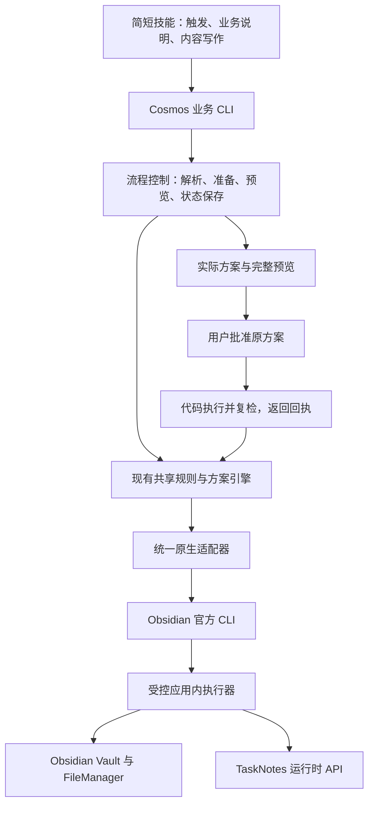

# Cosmos 本地 CLI 架构调研与结论

调研日期：2026-10-11。问题：在已有 Obsidian 官方 CLI、TaskNotes 和 Cosmos 规则/模板的前提下，如何让代码承担确定性工作，技能正文仅保留必要引导。

> 历史结论说明：本文形成于用户决定独立重建之前。2026-10-11 随后的决定要求新仓库、新架构及逐项继承审查；本文的“保留现有引擎”建议已由新开发设计取代。本文作为调研证据完整保存。

**当时结论：保留 Cosmos 现有规则引擎和原生执行通道，在其上增加管理业务流程的 CLI。让代码负责规则选择、状态保存、参数传递、执行和复检；模型负责理解需求和写内容。MCP 可以继续作为同一服务的另一种接口，不是本次改造的前提。**

本次深入阅读了 9 个直接相关项目的文档与关键源码，并查看部分测试源码。另筛查了两个相关项目。这里的“阅读测试”不等于在本机运行测试；没有安装这些项目，也没有执行业务写入。链接指向调研时可访问的默认分支，后续实施需核对实际版本。

## 1. 相似项目与可借鉴机制

### 1.1 Obsidian 官方 CLI 与官方技能

官方 CLI 提供模板创建、属性操作、搜索、链接、移动和应用内 JavaScript 执行。明确的 `vault` 选择及库内精确 `path` 应由适配器统一处理；不能依赖当前活动笔记。移动时的链接更新取决于库设置。原生 `tasks/task` 针对 Markdown 复选框及行号，不能替代 TaskNotes 的任务笔记模型。[官方 CLI 文档](https://obsidian.md/help/cli)

`kepano/obsidian-skills` 的 `obsidian-cli/SKILL.md` 只有 97 行，主要是触发说明、语法、示例和按需帮助，操作由现成 CLI 完成。它没有实现 Cosmos 的业务规则，也不能证明仅靠缩短正文即可获得稳定流程。官方文档与技能中默认库选择的描述也有差别，说明能力与行为应以实际版本探测为准。[技能源码](https://github.com/kepano/obsidian-skills/blob/main/skills/obsidian-cli/SKILL.md)

**采用：短技能入口、原生执行、按需帮助。补充：Cosmos 自己的业务约束和流程控制代码。**

### 1.2 TaskNotes：本机最直接相关的业务执行实现

`captureCommand.ts` 将 CLI 参数转换为任务数据，再调用 `plugin.taskService.createTask`。转换代码处理显式参数覆盖、列表、提醒、周期锚点及数值检查。`literal` 可以避免对已经结构化的标题再次做自然语言解释。[命令实现](https://github.com/callumalpass/tasknotes/blob/main/src/cli/commands/captureCommand.ts)、[参数转换](https://github.com/callumalpass/tasknotes/blob/main/src/services/buildTaskCreationDataFromCli.ts)

`TaskCreationService` 处理默认值、文件名、目录、字段映射、模板、YAML、缓存和事件；这些不是 CLI 客户端临时复制的逻辑。运行时 API 提供版本、能力、目录项、验证和生命周期接口，并复用插件服务。[任务创建服务](https://github.com/callumalpass/tasknotes/blob/main/src/services/task-service/TaskCreationService.ts)、[API 实现](https://github.com/callumalpass/tasknotes/blob/main/src/api/TaskNotesAPI.ts)、[运行时 API 文档](https://github.com/callumalpass/tasknotes/blob/main/docs/javascript-api.md)

本机 manifest 是 TaskNotes 4.13.8，最低 Obsidian 版本 1.12.2；已安装代码中存在按插件 ID 拼接名称的 CLI 注册逻辑。静态文件中找不到完整 `tasknotes:capture` 字符串不能据此断言没有该命令。后续需用实际 CLI 帮助及运行时能力核验可用接口，本次未运行创建命令。

**采用：继续复用 TaskNotes 运行时 API；适配器探测能力，业务规则由 Cosmos 补充。不能把 TaskNotes 任务退化为直接写 YAML 或勾选一行。**

### 1.3 TaskNotes Workflows：最接近缺失的流程控制层

这个配套项目用注册的步骤执行业务。`WorkflowEngine` 检查前置能力、并发组、条件和批量上限，按序运行并保存步骤状态与耗时，失败时按策略停止。`StepRegistry` 集中定义步骤、输入输出及写入属性；任务修改步骤在 dry-run 时返回拟执行内容，实际执行调用 TaskNotes API。[流程引擎](https://github.com/callumalpass/tasknotes-workflows/blob/main/src/workflowEngine.ts)、[步骤注册表](https://github.com/callumalpass/tasknotes-workflows/blob/main/src/stepRegistry.ts)

**采用：有限的业务操作注册表、代码管理步骤与状态、统一错误记录。无需为本次修复安装整个插件、引入定时自动化或开放任意脚本步骤。** Cosmos 的不可变方案与批准后执行，比这里的普通 dry-run 更符合现有需求，应继续保留。

### 1.4 Obsidian Copilot：集中封装 CLI 的成熟参考

Copilot 的工具层通过枚举和参数检查选择操作，共用 `ObsidianCliClient`。客户端统一组装 argv、处理多行参数、超时、缓冲区、窗口隐藏和进程结果，返回退出码、错误、标准输出及耗时；仅在找不到可执行文件时尝试其他路径。[工具定义](https://github.com/logancyang/obsidian-copilot/blob/master/src/tools/ObsidianCliTools.ts)、[客户端](https://github.com/logancyang/obsidian-copilot/blob/master/src/services/obsidianCli/ObsidianCliClient.ts)

其客户端测试涉及库参数位置、多行文本、执行失败和路径回退。这些测试使用模拟进程，不能当成用户 Windows 环境的实际验收。[测试源码](https://github.com/logancyang/obsidian-copilot/blob/master/src/services/obsidianCli/ObsidianCliClient.test.ts)

**采用：一个原生适配器承担所有进程细节，返回结构化结果。无需复制它的完整聊天产品。**

### 1.5 Claudian：宿主与技能的职责边界

Claudian 的权限适配代码把批准、拒绝和取消映射到提供方的权限响应；动作描述代码负责呈现工具与输入。[ACP 权限适配器](https://github.com/YishenTu/claudian/blob/main/src/providers/acp/ACPPermissionAdapter.ts)、[动作描述](https://github.com/YishenTu/claudian/blob/main/src/core/security/approvalRules.ts)

**采用：把宿主权限与 Cosmos 业务校验分开。** 这些源码证明存在权限交接机制，不能据此声称任意插件或技能都能阻止模型通过其他工具操作文件。是否能限制绕过，还取决于实际提供方、权限模式及宿主配置。

### 1.6 Obsidian VFS：路径检查与受控读取

VFS 的路径模块在代码里检查库边界、允许/禁止目录及符号链接；读取文件前调用验证。CLI 实现用队列串行化调用并解析结果。[路径模块](https://github.com/otaviof/obsidian-vfs/blob/main/packages/core/src/path-security.ts)、[文件读取](https://github.com/otaviof/obsidian-vfs/blob/main/packages/core/src/read-file.ts)、[CLI 实现](https://github.com/otaviof/obsidian-vfs/blob/main/packages/core/src/obsidian-cli.ts)

**采用：把路径和范围检查放进代码。** 它的职责是文件系统访问，不是 Cosmos 生命周期。源码中的部分命令形式与当前官方文档不同，不能原样照搬；也不能仅凭有边界检查就宣称完成了全部安全验证。

### 1.7 Storks/obsidian-mcp：轻量传输包装样例

`runner.py` 根据命令定义生成参数数组，用 `asyncio.create_subprocess_exec` 调用 CLI，并处理超时和退出错误。MCP 没有取代官方 CLI，只提供另一种调用入口。[runner 源码](https://github.com/Storks/obsidian-mcp/blob/master/src/obsidian_mcp/runner.py)

**采用：传输与执行分离。** 项目规模较小，错误主要返回文本，不适合作为 Cosmos 业务状态和回执设计的主要依据。

### 1.8 ZethicTech/obsidian-mcp：另一种 CLI 包装与测试参考

`cli.ts` 使用 `execFile` 和 argv，配置库及可执行路径，处理取消、超时与找不到程序。测试检查特殊字符保持参数值，以及未知工具的错误返回。[CLI 源码](https://github.com/ZethicTech/obsidian-mcp/blob/main/src/cli.ts)、[测试源码](https://github.com/ZethicTech/obsidian-mcp/blob/main/src/__tests__/security.test.ts)

**采用：无 shell 的参数传递、明确取消与错误。** 部分测试只检查参数数组或模拟调用，不能视为完整集成验证；普通进程输出也不足以确认应用内异步写入是否完成。现有 Cosmos 回执比这类包装更适合保留。

### 1.9 sooneocean/obsidian-agent：业务命令封装样例

`note` 命令将类型检查、目录选择、模板渲染、关联和索引更新封装成一次业务操作；模型无需逐项实现。模板引擎从库模板或内置模板加载并替换变量。[业务命令](https://github.com/sooneocean/obsidian-agent/blob/main/src/commands/note.mjs)、[模板引擎](https://github.com/sooneocean/obsidian-agent/blob/main/src/templates.mjs)

**采用：用业务命令隐藏机械步骤。** 不采用它的分类体系、直接文件写入、正则替换属性和自动扩散修改关联文件。它与现有 Cosmos/TaskNotes 的语义和预览范围不一致，适合作为小型结构样例。

另外筛查了 [claudesidian](https://github.com/heyitsnoah/claudesidian) 和 [ProxyLandLLC/obsidian-agent-cli](https://github.com/ProxyLandLLC/obsidian-agent-cli)。前者偏知识库起步模板与提示工作流；后者增加 REST 插件依赖。两者都不作为本次核心架构依据。前一轮 Notion 与 Blinko 的研究仅作为业务接口设计背景，本轮以上述直接相关源码为主。

## 2. 对现有 Cosmos 的判断

现有代码不是纯提示词实现，也不需要推倒重做：

- `operations.mjs`、`preparation.mjs`、`templates.mjs`、`planner.mjs` 已承担操作、规则、模板和方案校验。
- `prepared-operations.mjs`、`protocol.mjs`、`dependencies.mjs` 已管理准备结果、方案绑定及依赖核验。
- `transport.mjs` 已用官方 CLI 的 `eval` 进入受控 runtime；`spawn` 使用参数数组、`shell:false` 和 `windowsHide:true`。它核验实际库与运行环境，并处理回执和结果不确定状态。
- `runtime.mjs` 已复用 Obsidian 的属性、改名等接口及 TaskNotes API v1，任务创建调用 `api.tasks.create`。
- CLI 与 MCP 已共用 `createService`，无需各建一套业务引擎。

**缺口在面向模型的流程接口。** 当前 `invocationContract()` 仍让模型负责准备输入文件、保存结果、选择 `/planInput`、另存正文、选择 `/applyInput`、携带批准标记和选择 `/checkInput`。其中一些已有 CLI 辅助选项，但模型仍是整个流程的控制者。参数与字段错误可以被代码拒绝，重复探索和机械交接仍主要靠说明约束。

此前真实会话的规划约 178 秒，而 plan 终端命令约 0.5 秒。这个记录说明耗时不能只归因于业务 CLI；它不能进一步区分上游排队、推理或传输等待。精简交接可减少额外模型回合，实际提速仍须同环境测量。

## 3. 推荐的职责分配

这是综合参考后的设计建议，不是声称所有项目都有相同架构。

| 职责 | 应由谁承担 |
| --- | --- |
| 理解用户意图、区分模糊需求、撰写正文 | 模型；真正影响结果的歧义才询问用户 |
| 操作范围、类型与字段检查、合法生命周期 | 操作注册表与规则代码 |
| 当前模板选择、允许字段、内容结构验证 | 模板代码；按需向模型返回写作要求 |
| 草稿、准备结果、原方案、指纹及中间文件 | 流程控制代码 |
| 编码、参数序列化、CLI 路径与库定位 | CLI 与原生适配器 |
| 任务日期、状态、映射、周期行为 | TaskNotes 服务；Cosmos 校验业务关系 |
| 执行、复检、回执、结果不确定处理 | 引擎与流程控制代码 |
| 用户是否批准、是否允许绕过其他工具 | 会话与宿主权限边界 |

业务入口应围绕创建任务、创建实体、补正文、合法推进、文件修改、周期记录和发布等有限操作组织，仍复用原规则。模型传业务数据或正文，CLI 管理库外状态文件；不再要求模型复制内部编号、哈希或决定下一次指针选择。

**简单任务：** 数据齐全时一次命令在内部完成准备与规划，返回实际摘要及完整预览。用户批准后，一次提交命令在内部执行并复检。

**需要长正文的实体：** 先返回当前选定模板的可写字段和写作要求，模型填写，再用草稿句柄生成预览。模板信息没有进入上下文时，不应为了追求“一次调用”让模型猜结构。内部准备、绑定和保存仍由代码完成。

这两个路径必须保留预览到批准的边界，不能把全部流程压成一次自动写入。不能简单用多个通用 `create/property:set` 命令替换现有业务执行，否则会产生中间状态并削弱方案核验。复杂操作继续使用受控应用内执行器。

## 4. “代码强制”的实际范围

操作注册表可以作为 Schema、帮助、CLI 输入校验和接口描述的共同来源；动态模板仍来自实际库。这样修改字段与约束不必同步重写多份技能说明。

引擎可以强制拒绝越界路径、未登记分类、无效关系、不合法阶段、过期方案、内容不符和不确定结果的重复执行。工作流代码也可以强制完成必要内部步骤。

但普通 skill 脚本不能阻止拥有任意终端和文件写入权限的模型绕过入口。现有 `approved:true`/`--approved` 是调用者声明，方案指纹保证批准对象的一致性，本身不是人类批准证据。若以后要求完全强制入口或证明人类批准，需要宿主权限或可信批准机制配合；本次不能仅改正文就宣称实现。本调研没有修改宿主权限。

## 5. 实施与验收建议

1. 在原引擎之上实现业务入口和流程控制，保留现有准备、方案及回执兼容性。先覆盖真实高频的任务创建与实体创建，验证后贯通其余技能。
2. 由代码自动保存和继承内部结果，并将批准后的执行与复检封装；只向模型返回它当前需要的字段、预览及明确错误。
3. 再精简十个技能的正文，保留适用范围、语义写作要求、入口示例和必要交互说明。不要只先删提示，再让模型继续承担旧流程。
4. 按现有约定在 GitHub Actions 运行构建和自动验收，再做本机安装与原生会话核验；本次没有运行这些检查或更换安装。

验收需覆盖：材料齐全任务；按动态模板写长正文；同名目标与信息缺失；非法生命周期；批准后源文件或模板改变；中文、多行及特殊字符；执行完成但保存结果失败；应用内结果不确定。除产物与规则检查，还要记录宿主工具调用、额外探索、模型响应回合及规划/执行总耗时。模拟测试通过不代表本机体验通过，达到数量预算也不代表速度达标。

**最终选择：以 TaskNotes 的服务复用、Workflows 的流程代码和 Copilot 的原生客户端为主要参考。保留现有 Cosmos 引擎，补业务流程 CLI，再让技能退回精简的引导与写作层。此次交付是调研结论，尚未实现或安装这套改造。**
